# thronectl

Run your coding agents from a keyboard that fits in your pocket.

thronectl has two parts:

- **Firmware** for the M5Stack **Cardputer ADV** (StampS3A, ESP32-S3FN8, 1.14" ST7789V2 IPS).
- **A host daemon** for macOS and Linux. It runs your agent CLIs in terminals on the host and talks to the device over an encrypted link, on Wi-Fi or Bluetooth LE.

From the device you can start, watch, prompt, approve and stop agents (Claude Code, Codex, Pi, Cursor Agent, Antigravity, Gemini CLI, OpenCode, Amp and more). You can also open a real shell on the host, see CPU, memory, disk and network levels, kill processes, and talk to your agents with push-to-talk. Replies are read back on the device speaker.

| | | |
|---|---|---|
| 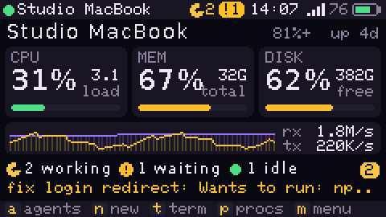 | 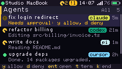 | 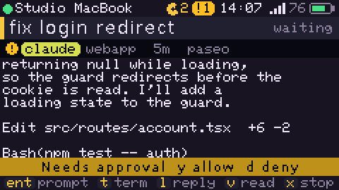 |
| Dashboard: host load, agent counts, alerts | Every agent, with live status | Output tail, approve or deny, prompt |
| 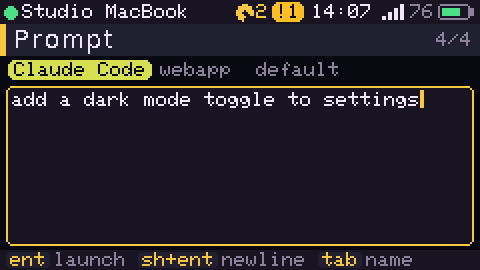 | 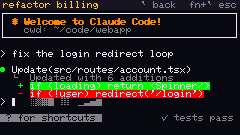 | 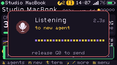 |
| Launch wizard: harness, folder, mode, prompt | Full terminal: shell or attach to an agent | Hold G0 and talk |
| 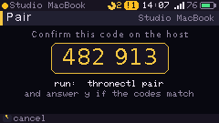 | 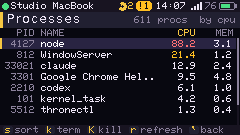 | 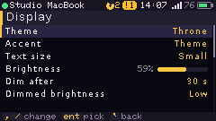 |
| Pairing code, confirmed on the host | Top processes, terminate or kill | 15 themes, 10 accent colors, three text sizes |
| 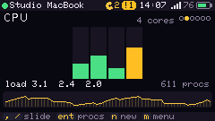 | 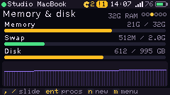 | 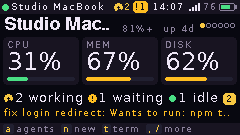 |
| Dashboard slides: `,` and `/` or `<` and `>` | Memory, swap and disk | Large text size: bigger, shows less |
| 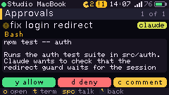 | 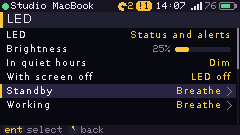 | 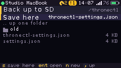 |
| Approvals: one key to allow, deny or comment | LED effects for each state and alert | Settings backup to any SD folder |
| 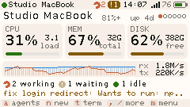 | 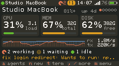 | 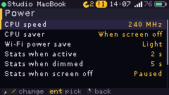 |
| Absolutely Light (Claude-inspired) | Absolutely Dark | CPU, Wi-Fi and stats power saving |
| 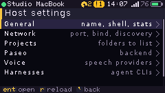 | 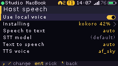 | 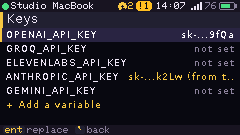 |
| Edit the daemon's config from the device | Local voice: install and switch on | API keys, shown masked |
| 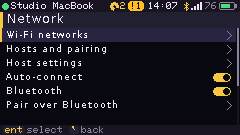 |  | 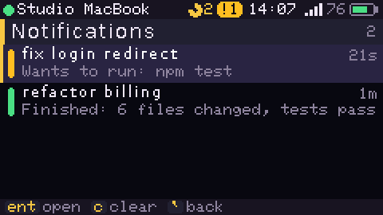 |
| Bluetooth link when there is no shared Wi-Fi | Simple mode: one approval at a time | Alerts you missed |

## Quick start

### 1. Install the daemon (macOS or Linux)

Needs Node.js 20.10 or newer.

```sh
git clone https://github.com/yannelli/thronectl.git
cd thronectl/daemon
npm install
npm run build
npm link            # puts `thronectl` and its short alias `throne` on your PATH
thronectl doctor    # shows which agent CLIs, Paseo and voice providers it found
thronectl install   # start at login (launchd on macOS, systemd --user on Linux)
```

To run it in the foreground instead: `thronectl daemon`. Pairing requests are then asked in that terminal.

### 2. Flash the Cardputer ADV

Get `thronectl-cardputer-adv-v<version>.bin` from the [releases](https://github.com/yannelli/thronectl/releases). It is one merged image for offset `0x0`.

- **[Launcher](https://github.com/bmorcelli/Launcher):** copy the `.bin` to the SD card, then in Launcher pick SD, select the file and choose Install. Launcher reads the partition table in the image and installs only the app. Factory reset in thronectl clears only its own data, so Launcher keeps its settings.
- **Browser:** open <https://espressif.github.io/esptool-js/>, connect, set the flash address to `0x0`, pick the `.bin`, then press Program.
- **esptool:**

  ```sh
  pip install esptool
  esptool.py --chip esp32s3 --baud 1500000 write_flash 0x0 thronectl-cardputer-adv-v0.2.0.bin
  ```

- **From source:** `cd firmware && pio run -t upload`

If the port does not show up, hold **G0** while you plug in USB. This puts the chip in download mode.

### 3. Pair

1. On the device, join Wi-Fi (the Wi-Fi screen opens on first boot).
2. The Hosts screen lists daemons on your network. Select yours and press **Enter**. To add a host by IP, press **a**.
3. The device shows a 6-digit code. On the computer run:

   ```sh
   thronectl pair
   ```

   Check that the codes match and answer **y**.
4. The device remembers the host and reconnects by itself. The host remembers the device. Later connections skip pairing.

To list or remove paired devices, use `thronectl devices` and `thronectl devices rm <name|id>`.

## Updating

```sh
throne update
```

This updates the git checkout and rebuilds the daemon. Then it restarts the login service and offers new firmware to each connected device. `throne` is the short alias for `thronectl`. Add `--yes` to skip the questions. Add `--no-firmware` to update only the daemon.

To send firmware only, run `throne flash`. It picks the newest image from the latest GitHub release (needs the GitHub CLI, `gh`) or from `firmware/dist`. You can also give a file and a device: `throne flash path/to/image.bin --device <name>`.

Confirm the update on the device. What happens next depends on how thronectl was installed:

- **Standalone** (flashed at `0x0`): the device writes the new app to its spare slot and checks it before it restarts. If the check fails, the old firmware stays.
- **Launcher:** Launcher owns the app slots, so the device saves `thronectl-cardputer-adv-v<version>.bin` to the SD card. Reboot, press any key on the Launcher screen, open SD, pick the file and choose Install.

**From the device:** Settings > Device > Check for updates asks the host for the newest firmware. If there is one, confirm once and it installs. If the firmware is current and the host runs from a git checkout, the device offers to run `throne update` on the host. The daemon then restarts and the device reconnects.

Without a host, copy the `.bin` to the SD card. Under Launcher, install it from Launcher. On a standalone install, open Settings > Device > Update from SD card.

Firmware older than 0.2.0 cannot update over Wi-Fi, so install 0.2.0 once by hand (step 2 above). A daemon older than 0.2.0 has no `update` command. Upgrade it once by hand:

```sh
cd thronectl && git pull && cd daemon && npm install && npm run build && npm link
```

## Using it

The Cardputer has no arrow keys. In menus, the keys printed with arrows work without **fn**: `;` up, `.` down, `,` left, `/` right. `` ` `` (the Esc keycap) goes back from every screen, text fields and the agent prompt too. Backspace also goes back outside text fields. In text fields and the terminal, hold **fn** for arrows. **fn+`** is Esc. Opt+`` ` `` types a backtick. `[` and `]` page through long lists. Space starts talking on screens that do not type, and a second press sends. Opt+k shows all shortcuts on the device.

### Everywhere

| Key | Action |
|-----|--------|
| **G0** (hold) | Talk. Release to send. "Tap to toggle" mode is in Settings > Voice |
| Space | Talk, then Space or Enter to send (Settings > Voice > Space to talk) |
| `` ` `` / Backspace | Back |
| `[` / `]` | Page up / page down in lists |
| Opt+h | Home |
| Opt+a | Agents |
| Opt+y | Approvals |
| Opt+n | New agent |
| Opt+t | Shell on the host |
| Opt+s | Settings |
| Opt+m | Mute or unmute (keeps the volume level) |
| Opt+d | Do not disturb on or off |
| Opt+- / Opt+= | Volume down / up |
| Opt+[ / Opt+] | Brightness down / up |
| Opt+k | Shortcut list |
| Opt+Enter | Go-to menu |

The status bar shows a crescent while alerts are silent (do not disturb or quiet hours) and a crossed speaker while muted.

### Home

`a` agents, `y` approvals, `n` new agent, `t` shell, `p` processes, `l` notifications, `h` hosts, `w` Wi-Fi, `s` settings, `m` for the menu, `c` connect.

The dashboard opens on the overview. `,` and `/` (or `<` and `>`) flip through detail slides, and `1` to `6` jump to one: CPU (per-core bars, load, history), memory and disk (memory, swap, disk, history), network (down and up rates, history, Wi-Fi signal, latency), agents (counts and the full list) and host (hostname, system, user, uptime, battery, daemon). The dots at the top right show the slide. Enter opens the matching screen. Settings > Display > Rotate dashboard flips slides on a timer.

When the link is down, Home shows when the next automatic retry happens. Press `c` to retry now.

### Agents

| Key | Action |
|-----|--------|
| Enter | Open the agent |
| `p` | Send a prompt |
| `y` / `d` | Allow or deny a pending permission |
| `t` | Open its terminal (attach) |
| `x` | Interrupt the current turn |
| `k` | End the agent (Paseo agents are archived) |
| `v` | Read the last reply aloud |
| `l` | Show the last reply (in the agent view) |
| `f` | Filter: all, active, waiting |
| `n` | New agent |
| `1` to `9` | Open the agent at that place in the list |
| `[` / `]` | In the agent view: the agent before or after |

Hold **G0** on an agent to speak a prompt to it. On any other screen, speech starts a new agent with your words as the prompt. If you have launched an agent before, the wizard reuses your last choices and goes straight to the prompt step. Press Enter to launch.

### Approvals

One card for each agent that waits for you: the agent, the tool it wants to use and what it asks. `y` or Enter allows, `d` denies, and `c` denies with a comment that goes to the agent. Speech on this screen becomes a comment too. `,` and `/` move between cards, `Y` allows all of them, `o` opens the agent and `t` its terminal.

**Simple mode** (Settings > Agents) makes the approval queue the home screen, for quick review away from your desk. When nothing waits, it shows "All clear" with the working and idle counts. `m` still opens the go-to menu.

### New agent wizard

Harness, then folder, then mode, then prompt. Enter goes forward and `` ` `` goes back. In the folder step, `c` types a path. In the prompt step, Tab sets a name and Shift+Enter adds a new line.

### Terminal

All keys go to the host. Opt+q closes the terminal.

| Key | Sends |
|-----|-------|
| fn + `;` `.` `,` `/` | Arrow keys |
| fn + Shift + up / down | Page up / page down |
| fn + Shift + left / right | Home / End |
| fn + `` ` `` | Esc |
| fn + 1 to 0, `-`, `=` | F1 to F12 |
| Ctrl + key | Control characters (Ctrl+C, Ctrl+D) |
| Alt + key | Meta (Esc prefix) |
| Tab / Shift+Tab | Tab / back-tab |

Two font sizes: 40x15 (default) and 60x20 (Settings > Display > Terminal font). The host runs the terminal emulator. The device draws box, block and braille characters itself, so agent TUIs look right.

### Other screens

- **Processes:** `s` sort by CPU or memory, `k` SIGTERM, `K` SIGKILL.
- **Hosts:** Enter connect or pair, `d` default host, `x` forget, `a` add by address, `r` rescan, `o` go offline.
- **Wi-Fi:** Enter join, `r` scan, `h` hidden network, `x` forget, `d` disconnect. Up to 5 networks are saved and tried in order.

## Settings on the device

| Group | Settings |
|-------|----------|
| Display | Theme, accent color, text size (Small, Medium or Large), brightness, dim after, dimmed brightness, screen off after, flip screen, terminal font, terminal output keeps screen on, 24-hour clock, battery percent, animations, boot splash, rotate dashboard, toast seconds |
| Sound | Volume, alert volume, voice volume, key clicks, alert sounds, do not disturb, quiet hours, finished turns (every turn, over 30 s, over 2 min, off), approval alerts, error alerts, remind while waiting, wake on alerts, startup chime, play all chimes |
| Voice | Read replies aloud, push to talk (hold or tap), space to talk, mic gain, send without review, host voice name, test speaker, host speech (local voice install and switch) |
| LED | LED mode (off, status and alerts, alerts only), brightness, in quiet hours, with screen off, an effect for each state and alert, reset |
| Agents | Simple mode, confirm before ending, open terminal on launch, show exited agents, default harness, clear notifications |
| Network | Wi-Fi networks, hosts and pairing, host settings, auto-connect, Bluetooth, pair over Bluetooth, device name, time zone (or from host), disconnect, reconnect |
| Keyboard | Key repeat delay and rate, shortcut list |
| Power | CPU speed, CPU saver, Wi-Fi power save, stats when active, dimmed and screen off, battery saver at 20%, turn off at 3%, power off |
| Device | About, check for updates, update from SD card, back up settings to SD, restore settings from SD, reset settings (keeps Wi-Fi and pairing), reboot, factory reset |

Themes: Throne, Midnight, Tokyo Night, Catppuccin, Dracula, Nord, Gruvbox, Solarized, Synthwave, Matrix, Amber CRT, Paper, and the Claude-inspired Absolutely Light, Absolutely Dark and Absolutely Black. Absolutely Light and Dark use the Claude app's light and dark palettes (ivory or warm charcoal with the clay accent). Absolutely Black is a darker variant of the dark palette. The Clay accent puts the same orange on any theme.

**Text size.** Small is the dense layout. Medium uses 11 and 12 px DejaVu fonts. Large is the old "Normal": the largest fonts and tallest rows, so each screen shows the least. Medium and Large leave out the history strip on the dashboard overview (the CPU and Network slides still have it). The terminal keeps its own font setting. A saved "Normal" setting becomes Large.

**LED.** Each state and alert has its own effect: Standby, Working, Waiting, Offline and Charging run in the background; Done, Attention, Error and Info play once. Pick an effect (solid, breathe, pulse, blink, double blink, triple blink, heartbeat, strobe, flicker, candle, sparkle, swell, ramp, rainbow, rainbow breath, color steps), a color (the theme accent or one of 20), a speed, a level and, for alerts, a length (cycles, seconds, or until a key press). The LED plays the effect while its page is open. Rainbow, rainbow breath and color steps use their own colors. Colors are gamma corrected, so the LED shows the same hue as the screen. Defaults: a slow dim breath on standby, a breath while agents work, a pulse while one waits, a double blink when a turn ends, a fast blink for approvals and a strobe on errors.

The LED shares its power supply with the display backlight. While an LED effect is active, the backlight stays at full brightness, including the dark parts of blinks and breathing. This prevents the dimmer from interrupting LED power. Your selected display brightness returns when the effect ends or LEDs are disabled. With the screen off, the LED is dark unless "With screen off" is "Keep lit": the panel then sleeps with the backlight on behind it. Keeping this supply on costs battery.

**Alerts.** Filtered alerts still go to Notifications, without a toast, sound or wake. During do not disturb and quiet hours, alerts show a toast but make no sound, do not wake the screen and do not flash the LED. "Remind while waiting" chimes again while an agent waits for approval. The daemon sends the turn length with each finished-turn alert, so "Turns over 2 min" skips quick replies.

**Settings backup.** Back up and Restore open a folder browser on the SD card. Enter or `/` opens a folder, `,` goes up, `n` makes a folder and `s` saves `thronectl-settings.json` in the open folder. Restore lists `.json` files, so backups from 0.3 (`/thronectl/settings.json`) still load. The device remembers the last folder. The backup includes saved Wi-Fi passwords. The device key is not in it, so after a factory reset you pair again.

The card must be FAT32. exFAT cards (most cards over 32 GB) do not mount: the browser says so and `f` formats the card as FAT32, which erases it. A card that already has a FAT volume is never formatted.

### Power saving

| Setting | What it does |
|---------|--------------|
| CPU speed | 240, 160 or 80 MHz. These are the only ESP32-S3 speeds that keep Wi-Fi running. 333 MHz is not supported: 240 MHz is the chip's maximum, and the 40, 20 and 10 MHz crystal speeds stop the radio |
| CPU saver | Drops to 80 MHz when the screen is off (default), or when it dims too. Voice and updates always run at full speed |
| Wi-Fi power save | Off (lowest latency), Light (modem sleep between beacons, the default), Max (sleeps through beacons, replies arrive later), or Max only while the screen is off |
| Stats when active / dimmed / screen off | How often the host sends stats in each display state. Screen off can pause stats. Screens other than the dashboard get the dimmed rate |
| Battery saver at 20% | On battery at 20% or less: 80 MHz, Max Wi-Fi power save, stats every 10 s or slower, brightness capped. Ends at 25% or on charge |
| Turn off at 3% | Warns at 10%, then turns off 15 s after it reaches 3% unless you plug in |

The main loop also sleeps longer while the screen is dimmed or off. Automatic light sleep and dynamic frequency scaling are not available: the prebuilt Arduino ESP32 core is compiled without power management (`CONFIG_PM_ENABLE`).

## Agents and harnesses

The daemon finds agent CLIs on your login shell `PATH`. It runs each one in a pseudo-terminal, so you can attach from the device and see the real TUI.

| Harness | Binary | Modes |
|---------|--------|-------|
| Claude Code | `claude` | Ask, Accept edits, Plan, Bypass |
| Codex | `codex` | Ask, Full auto, YOLO |
| Pi | `pi` | Ask |
| Cursor | `cursor-agent` or `agent` | Ask, Force |
| Antigravity | `agy` or `antigravity` | Ask, Auto, Plan, Bypass |
| Gemini CLI | `gemini` | Ask, Auto edit, YOLO |
| OpenCode | `opencode` | Ask, Auto |
| Amp | `amp` | Ask |
| Mistral Vibe | `vibe` | Ask, Auto approve |
| Junie | `junie` | Ask, Brave, Plan |
| Grok, Kiro, Amazon Q | `grok`, `kiro-cli`, `q` | Ask |

Agent status comes from the terminal output: **working** while output changes, **waiting** when a permission prompt is on screen, **idle** when it goes quiet, **exited** when the process ends. The device gets a notification for each change. It chimes, flashes the LED, and can read the reply aloud.

**Paseo:** if the [`paseo`](https://paseo.sh) CLI is installed, its providers appear as `paseo:<provider>` harnesses, and agents that Paseo manages show up next to the direct ones. Create, prompt, approve, interrupt, archive and attach all go through `paseo`.

Override or add a harness in the config:

```json
{ "harness": {
    "claude": { "args": ["--model", "opus"] },
    "aider":  { "bin": "aider", "name": "Aider" },
    "gemini": { "disabled": true } } }
```

## Voice

Hold **G0**, talk, release. The device streams 16 kHz audio to the daemon, which transcribes it. Spoken replies come back as audio on the device speaker.

**Local voice (the default).** The daemon can do speech on the host itself, with the same models Paseo uses: Parakeet TDT 0.6B for speech to text and Kokoro 82M for text to speech, run by [sherpa-onnx](https://github.com/k2-fsa/sherpa-onnx). No API keys are needed and audio stays on the host. If Paseo's models are already in `~/.paseo/models/local-speech`, the daemon uses them as they are. Otherwise install them, from the host or from the device:

```sh
thronectl voice install    # about 800 MB; --tts kokoro-int8-en-v0_19 is a 103 MB voice
thronectl voice status
```

On the device: Settings, Voice, Host speech. "Install local voice" shows the download size and the progress. "Use local voice" turns it on or off. Kokoro voices: `af`, `af_bella`, `af_nicole`, `af_sarah`, `af_sky`, `am_adam`, `am_michael`, `bf_emma`, `bf_isabella`, `bm_george`, `bm_lewis` (set one in Voice name). Speech starts when the first sentence is ready: 1 to 2 s on the ARM Linux test host. The models run in a separate process that uses about 1.9 GB of memory and exits after 5 minutes with no requests. `sherpa-onnx-node` is an optional dependency: where it does not install, the daemon falls back to the providers below. Licences: Parakeet CC-BY-4.0, Kokoro Apache-2.0, espeak-ng data GPL-3.0.

Put API keys in `~/.config/thronectl/env` (one `KEY=value` per line), or set them from the device in Host settings, Keys. The daemon loads this file at start.

**Speech to text**, first match wins:

1. Local voice, when it is installed and on
2. `OPENAI_API_KEY`: `gpt-4o-mini-transcribe`
3. `GROQ_API_KEY`: `whisper-large-v3-turbo`
4. A local command, for example whisper.cpp:

   ```sh
   thronectl config set voice.stt.command "whisper-cli -m ~/models/ggml-base.en.bin -nt -f {wav}"
   ```

**Text to speech**, first match wins: local voice, macOS `say`, OpenAI, ElevenLabs (with `voice.tts.voice` set), Piper (with `voice.tts.model` set), `espeak-ng`, or `voice.tts.command` (`{text}` and optional `{out}` placeholders). Set a voice per device in Settings > Voice > Voice name.

Push a message from scripts:

```sh
thronectl notify "Deploy finished" "prod is green" --kind done
thronectl say "Build failed on main"
```

**Host settings.** Settings, Network, Host settings edits the daemon's own config from the device. The groups follow `config.json`: general, network, projects, Paseo, voice, harnesses and keys. Harnesses lists each CLI as ready, missing or off. Open one to turn it off, rename it, change its command or arguments, or add your own. Keys lists API keys and other variables from `~/.config/thronectl/env`. They show masked, never in full. Enter replaces one, and an empty value removes it. Port, bind and discovery apply after "Restart daemon", which works when the daemon runs as a login service (`thronectl install`). With `allowShell` set to `false`, host settings are read-only on the device.

## Bluetooth

Bluetooth LE connects the device to the daemon when they are not on the same Wi-Fi network. For example, the laptop runs in your backpack and the Cardputer is in your hand.

1. Pair once. Use Wi-Fi (see Pair), or open Settings, Network, Pair over Bluetooth on the device. That opens a pairing window for 2 minutes. Keep the device near the host, run `thronectl pair` and accept the code.
2. On the device, turn on Settings, Network, Bluetooth. If Bluetooth was off at boot, accept the restart prompt. Pair over Bluetooth also offers this restart and opens its 2-minute window after boot. Once Bluetooth is on at boot, you can turn it off and back on without another restart.
3. When the device has no link, it advertises. A daemon in range that knows the device connects in a few seconds, with no prompt on either side.

You do not pair in the operating system's Bluetooth settings. The thronectl handshake and AES-GCM encryption run over Bluetooth the same as over Wi-Fi. A device refuses an unknown host unless its pairing window is open. The device does not advertise while it has a Wi-Fi link or is connecting to one.

The status bar shows the Bluetooth rune while Bluetooth is on. It is dim while the device waits, amber during the pairing window, and the accent color when the link runs over Bluetooth. A host that you paired over Bluetooth has no IP address. To use it over Wi-Fi too, select it once in Hosts when both are on the same network.

What the host needs:

- The daemon uses `@stoprocent/noble`, an optional dependency that `npm install` adds. It runs in a helper process, so a Bluetooth fault cannot stop the daemon. If the module or an adapter is missing, the daemon runs without Bluetooth and logs why.
- macOS: the app that runs the daemon needs Bluetooth access (System Settings, Privacy & Security, Bluetooth). If the log says that macOS stopped the Bluetooth helper, add Terminal there, or the `node` binary for the login service.
- Linux: BlueZ with `bluetoothd` running. The daemon uses BlueZ over D-Bus, so it needs no root.

Limits: Bluetooth is slower than Wi-Fi. Voice replies need about 32 KB/s and can stutter at long range. Firmware updates over Bluetooth take longer. Bluetooth starts only when at least 90 KB of heap is free, and shuts down if initialization leaves less than 32 KB. These thresholds are estimates; heap use and throughput still need hardware measurements. Bluetooth costs battery while it is on.

Status: this release was tested with a simulated radio on both sides (the daemon's helper process and the firmware's NimBLE code). It was not tested on real Bluetooth hardware.

## Configuration

`~/.config/thronectl/config.json` (or `$THRONECTL_HOME/config.json`). `thronectl config` prints it. `thronectl config get <key>` and `thronectl config set <key> <value>` read and change one value, and `set` tells a running daemon to reload. Restart the daemon after you change `port` or `bind`.

| Key | Default | Meaning |
|-----|---------|---------|
| `name` | host name | Name shown on the device |
| `port` | `4787` | TCP and UDP discovery port |
| `bind` | `0.0.0.0` | Listen address. Use a LAN or Tailscale IP to limit exposure |
| `discovery` | `true` | Answer device discovery broadcasts |
| `allowShell` | `true` | Allow shell terminals from the device |
| `shell` | `$SHELL` | Shell for the device terminal |
| `projectRoots` | `~/workspace`, `~/code`, `~/Developer`, ... | Folders scanned for git repos |
| `projects` | `[]` | Extra folders to pin in the project list |
| `paseo.enabled` | `"auto"` | Use the Paseo CLI when it is installed |
| `ble.enabled` | `"auto"` | Bluetooth LE link: `auto` uses it when the host has an adapter, `true` also logs a warning when it cannot start, `false` turns it off |
| `voice.stt.provider` | `"auto"` | `local`, `openai`, `groq`, `command`, `off` |
| `voice.tts.provider` | `"auto"` | `local`, `say`, `espeak`, `piper`, `openai`, `elevenlabs`, `command`, `off` |
| `voice.local.enabled` | `true` | `auto` tries local voice first |
| `voice.local.stt` | `"parakeet-tdt-0.6b-v2-int8"` | Or `parakeet-tdt-0.6b-v3-int8` (25 European languages) |
| `voice.local.tts` | `"kokoro-en-v0_19"` | Or `kokoro-int8-en-v0_19` (smaller) |
| `voice.local.threads`, `voice.local.speed` | `2`, `1.0` | CPU threads and speech speed |
| `voice.tts.maxChars` | `600` | Longest reply that is read aloud |
| `notify.desktop` | `true` | Desktop notification for pairing requests |
| `statsMs` | `2000` | Default stats interval |

## Security

- Each side has an X25519 key. Every connection does a static and an ephemeral key exchange. The device commits to its nonce before it sees the host's, so a man in the middle cannot choose keys that give a matching code.
- Both sides compute the 6-digit pairing code from the handshake transcript. You compare the codes and answer on the host. The device refuses to continue if the host's code differs from its own.
- After the handshake, every frame uses AES-256-GCM with a per-direction counter nonce. A frame that fails to decrypt closes the connection.
- The device pins the host key. If the key changes, it stops and asks you to forget the host and pair again.
- A paired device can run commands as your user. To turn off shell terminals, set `allowShell` to `false`. To limit the listen address, set `bind`.

The wire format is in [docs/protocol.md](docs/protocol.md).

## Troubleshooting

- **"No SD card found" or "Card needs FAT32".** Use a FAT32 card. The device tries 20, 10 and 4 MHz before it gives up.
- **The device restarted when an agent printed a lot.** 0.4.0 fixes this: the daemon caps replies at 32 KB and agent output at 12 KB, and the device drops a reply it has no memory for instead of crashing.

- **Agents or the shell fail with "posix_spawnp failed" (macOS).** node-pty 1.1 installs its `spawn-helper` without the execute bit. The daemon now fixes the bit itself when it starts a terminal, and `thronectl doctor` checks and fixes it too. If the install folder is read-only, run the `chmod +x` command the error message prints.
- **"X not found on the daemon's PATH".** The daemon checks the command and the folder before it starts an agent. Run `thronectl doctor`, or set an absolute path for the harness in the config.

## Development

```
daemon/     TypeScript host daemon and CLI
firmware/   PlatformIO project for the Cardputer ADV (Arduino, M5Unified, M5GFX)
docs/       Protocol spec and screenshots
```

- Daemon tests: `cd daemon && npm test`. They include an end-to-end run with a simulated device.
- Simulated device REPL: `thronectl sim`.
- Bluetooth HAL check: `firmware/tools/blecheck/run.sh` builds `src/hal/ble.cpp` for the host against a fake NimBLE. It checks advertising, the credit window, buffer wrap and reconnects under AddressSanitizer.
- LED output check: `bash firmware/tools/ledcheck/run.sh` checks shared power, color restore, GRB order, pulse timings, named colors and effects under AddressSanitizer and UBSan.
- Firmware build: `cd firmware && pio run`. To make the release image: `tools/merge.sh`.
- Screen snapshots without hardware: `firmware/tools/snapshot/build.sh`, then run the binary it prints with an output folder. It renders every screen to PNG with mock data.
- Key fuzzer: `firmware/tools/keyfuzz/run.sh [steps] [seed]` runs the real app loop under AddressSanitizer. It sends random keys, link and Wi-Fi changes, and firmware offers and chunks. It models the device clock (handlers run after the loop reads `millis()`) and fails if a key press leaves the screen off.
- Interop check: `firmware/tools/linkcheck/run.sh` builds the firmware link and crypto code for the host. It pairs with a throwaway daemon, runs the RPC methods and pushes a test firmware image with `ota.push`. It needs mbedTLS 2.28 (`libmbedtls-dev`, or set `MBEDTLS_ROOT`).

## Hardware notes

The full pin map, part notes and photos are in [docs/hardware](docs/hardware/README.md). Use the [reference index](docs/INDEX.md) for the LED power and timing decisions, toolchain versions and external datasheets before changing those drivers.

- Cardputer ADV: ESP32-S3FN8 (8 MB flash, no PSRAM), 240x135 ST7789V2, TCA8418 keyboard, ES8311 codec with speaker and mic, RGB LED on GPIO 21, G0 button.
- M5Unified cannot drive the LED on this core (its RMT bus is a stub before ESP-IDF 5), so the firmware uses the Arduino RMT driver with WS2812B-2020 timings.
- The charger's status pins are not wired. The device counts as charging when a USB host is attached or the battery voltage keeps rising. The battery percent comes from an averaged voltage and a LiPo curve.
- Power off is deep sleep: press G0 to wake it. The side switch is the real off.
- The speaker and the mic share one I2S bus, so playback stops while you talk.
- The firmware runs one loop. The screen redraws at 30 fps while you use it and slows down when idle to save battery.
- CPU clock: 240 MHz maximum. 240, 160 and 80 MHz work with Wi-Fi; see Power saving.
